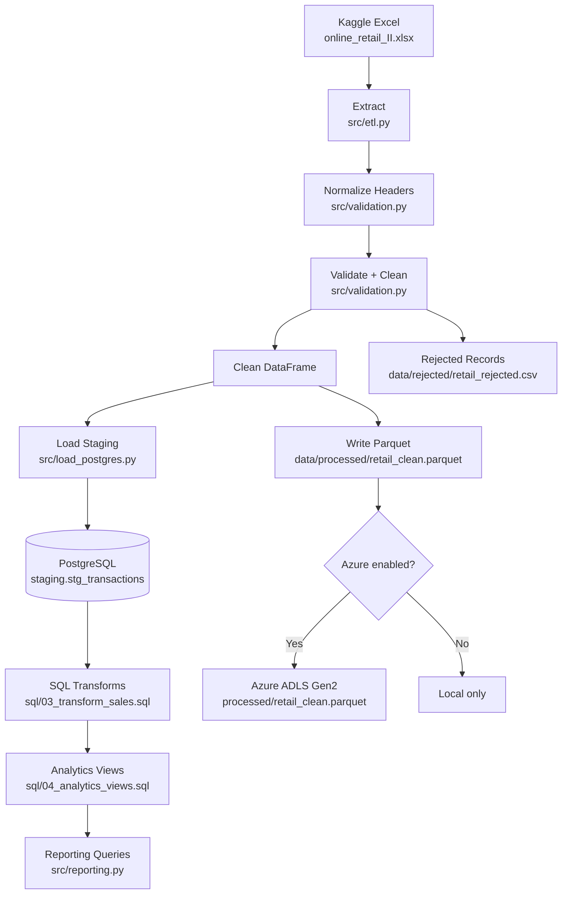
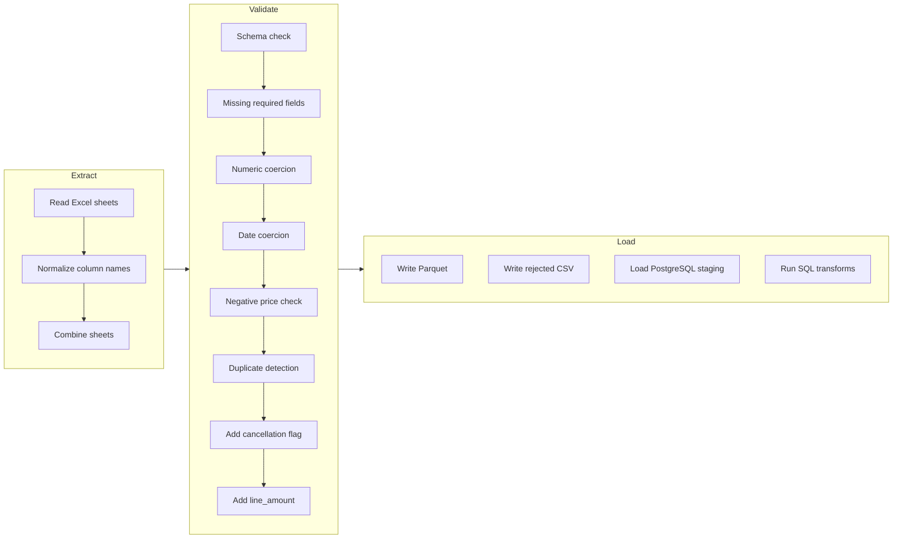

# 🛒 Retail Sales Data Engineering Pipeline

> **End-to-end data pipeline** — from raw Kaggle Excel data to analytics-ready PostgreSQL views and Parquet storage.  
> Built as a portfolio project demonstrating professional Data Engineering practices.

---

## 📌 Business Problem

A retail company has 525,000+ transaction records across two years stored in a raw Excel workbook.  
This data cannot be used for analytics directly because it contains:
- Missing customer IDs and descriptions
- Invalid or non-numeric quantities and prices
- Duplicate invoice lines
- Cancelled invoices mixed with real sales
- No structured schema or audit trail

**Objective:** Build a reliable, reproducible data pipeline that cleans, validates, stores, and makes this data queryable for business analytics.

---

## 🎯 Business Objectives

1. Ingest raw Excel data reliably without losing rows silently
2. Apply documented business rules to separate clean from rejected records
3. Store clean data in Parquet (columnar, compressed) for downstream analytics
4. Load clean data into PostgreSQL for SQL-based analytics
5. Provide pre-built SQL views for KPIs: sales trends, top products, returns, customer analysis
6. Log every pipeline run with a full audit record
7. Make the pipeline reproducible — running it twice produces the same result (idempotent)

---

## ✨ Key Features

| Feature | Description |
|---|---|
| 🔍 Multi-sheet detection | Automatically inspects workbook sheets; combines compatible sheets |
| 🧹 Data quality | 8 validation checks; rejected records written to CSV with reasons |
| ♻️ Idempotent | Same input → same output; Parquet overwrite, staging full-replace |
| 📦 Parquet storage | Columnar, snappy-compressed; readable by Spark, DuckDB, Pandas |
| 🐘 PostgreSQL | Staging table + SQL transformation layer + analytics views |
| 📊 10 analytics queries | Daily sales, monthly trends, top products, returns, customer count |
| 🔒 Secrets management | `.env` with validation; password never logged or printed |
| 🧪 Automated tests | Unit tests with synthetic DataFrames; integration tests skip without PG |
| ☁️ Azure ADLS Gen2 | Optional upload of Parquet files; disabled when not configured |
| 📝 Audit records | Every run logged with row counts, timestamps, status |

---

## 🏗️ Architecture



### Data Flow (detailed)



---

## 🔧 Technology Stack

| Technology | Role | Why chosen |
|---|---|---|
| **Python 3.12+** | Pipeline logic, ETL | Dominant DE language; rich ecosystem |
| **Pandas** | DataFrame operations | Fast in-memory data manipulation |
| **PyArrow** | Parquet read/write | Official Arrow implementation; columnar I/O |
| **openpyxl** | Excel reading | Handles `.xlsx` format reliably |
| **PostgreSQL 17** | Relational analytics DB | Industry-standard; supports complex SQL analytics |
| **SQLAlchemy 2** | DB abstraction layer | Safe URL building; connection pooling |
| **psycopg 3** | PostgreSQL driver | Modern asyncpg-compatible PG driver |
| **python-dotenv** | Secrets management | Keeps credentials out of code |
| **pytest** | Testing | Standard Python test framework |
| **Git + GitHub** | Version control | Industry standard |
| **Azure ADLS Gen2** | Cloud data lake (optional) | Industry-standard cloud storage for DE |

---

## 📁 Repository Structure

```
retail-data-engineering/
│
├── data/
│   ├── raw/                    # Source Excel file (NOT committed to git)
│   ├── processed/              # Clean Parquet output
│   ├── rejected/               # Rejected records CSV
│   └── sample/                 # Small samples for testing
│
├── logs/                       # Pipeline run logs
│
├── sql/
│   ├── 01_create_schema.sql    # Create staging schema
│   ├── 02_create_staging.sql   # Create staging table
│   ├── 03_transform_sales.sql  # Clean facts table
│   ├── 04_analytics_views.sql  # Business analytics views
│   └── 05_quality_checks.sql   # Data quality assertions
│
├── src/
│   ├── __init__.py
│   ├── config.py               # Configuration & secrets management
│   ├── etl.py                  # Extract phase — Excel → DataFrame
│   ├── validation.py           # Data quality rules
│   ├── transform.py            # Parquet I/O & type casting
│   ├── load_postgres.py        # PostgreSQL connection & staging load
│   ├── run_pipeline.py         # Main entry point
│   └── reporting.py            # Analytical query runner
│
├── tests/
│   ├── test_validation.py      # Unit tests for validation rules
│   ├── test_transform.py       # Parquet read/write tests
│   ├── test_etl.py             # Extraction tests
│   └── test_config.py          # Configuration validation tests
│
├── docs/
│   ├── architecture.md         # Detailed architecture notes
│   ├── data_dictionary.md      # Column definitions & business rules
│   ├── troubleshooting.md      # Common errors & fixes
│   └── interview_questions.md  # Interview prep (30+ Q&A)
│
├── .env.example                # Environment variable template
├── .gitignore                  # Excludes .env, data, venv
├── pyproject.toml              # Package metadata & dependencies
├── requirements.txt            # Pinned dependencies
└── README.md                   # This file
```

---

## 📊 Dataset

| Property | Value |
|---|---|
| **Source** | [Kaggle: Online Retail II](https://www.kaggle.com/datasets/mashlyn/online-retail-ii-uci) |
| **Original file** | `online_retail_II.xlsx` |
| **Approximate rows** | 525,461 (two sheets: Year 2009-2010, Year 2010-2011) |
| **License** | CC BY 4.0 (UCI Machine Learning Repository) |
| **Usage note** | Download from Kaggle; do not commit to Git (>50 MB) |

### Column Mapping (Source → Normalized)

| Source Header | Normalized Name | Description |
|---|---|---|
| `Invoice` / `InvoiceNo` | `invoice` | Invoice identifier |
| `StockCode` | `stockcode` | Product code |
| `Description` | `description` | Product description |
| `Quantity` | `quantity` | Units sold (negative = return) |
| `InvoiceDate` | `invoicedate` | Transaction timestamp |
| `Price` / `UnitPrice` | `price` | Unit price (GBP) |
| `Customer ID` / `CustomerID` | `customerid` | Customer identifier (nullable) |
| `Country` | `country` | Customer country |

---

## 📖 Data Dictionary

| Column | Type | Nullable | Business Rule |
|---|---|---|---|
| `invoice` | string | No | Required; starts with 'C' = cancellation |
| `stockcode` | string | No | Required; product identifier |
| `description` | string | Yes | Optional; logged when missing |
| `quantity` | int64 | No | Required; negative = return/credit |
| `invoicedate` | timestamp | No | Required; must be valid datetime |
| `price` | float64 | No | Required; must be >= 0 |
| `customerid` | float64 | Yes | Optional; many records have no customer |
| `country` | string | Yes | Optional |
| `line_amount` | float64 | No | **Derived**: quantity × price |
| `is_cancellation` | bool | No | **Derived**: invoice starts with 'C' |

---

## 🧹 Data Cleaning Rules

| Rule | Action |
|---|---|
| Missing `invoice` or `stockcode` | **Reject** with reason `null_invoice` / `null_stockcode` |
| Missing `quantity`, `price`, or `invoicedate` | **Reject** with reason `null_<field>` |
| Non-numeric `quantity` or `price` | **Reject** with reason `non_numeric_quantity` / `non_numeric_price` |
| Invalid date | **Reject** with reason `invalid_date` |
| `price < 0` | **Reject** with reason `negative_price` |
| `price == 0` | **Keep** — free items / samples are valid |
| Negative `quantity` | **Keep** — these are legitimate returns/credit notes |
| Invoice starts with 'C' | **Keep** — flagged as `is_cancellation = True` |
| Exact duplicate (invoice + stockcode + date + qty + price) | **Reject** second+ occurrence with reason `duplicate` |
| Missing `customerid` | **Keep** — flagged but not rejected |
| Missing `description` | **Keep** — logged warning |

**Reconciliation invariant:** `input_rows = clean_rows + rejected_rows`

---

## 🐘 Database Schema

```sql
-- Schema
CREATE SCHEMA IF NOT EXISTS staging;
CREATE SCHEMA IF NOT EXISTS analytics;

-- Staging table (full replace on each run)
staging.stg_transactions

-- Clean facts table
analytics.fact_sales

-- Views
analytics.v_daily_sales
analytics.v_monthly_trends
analytics.v_top_products
analytics.v_country_sales
analytics.v_return_analysis
```

---

## ⚙️ Setup Instructions (Windows / PowerShell)

### 1. Prerequisites

- Python 3.12+ (or use `uv` — already configured)
- PostgreSQL 17 installed locally
- Git

### 2. Clone the repository

```powershell
git clone https://github.com/YOUR_USERNAME/retail-data-engineering.git
cd retail-data-engineering
```

### 3. Create virtual environment and install packages

```powershell
# If you have uv installed (recommended):
uv sync

# OR using standard venv:
python -m venv .venv
.venv\Scripts\Activate.ps1
pip install -r requirements.txt
```

### 4. Place the dataset

Download `online_retail_II.xlsx` from Kaggle and place it at:
```
data\raw\online_retail_II.xlsx
```

### 5. Configure environment variables

```powershell
Copy-Item .env.example .env
# Edit .env with your actual PostgreSQL password
notepad .env
```

### 6. Verify PostgreSQL is running

```powershell
Get-Service -Name "postgresql*"
# If stopped:
Start-Service "postgresql-x64-17"
```

---

## 🐘 PostgreSQL Setup and Troubleshooting

### First-time setup

```powershell
# Connect as postgres superuser
psql -U postgres -h localhost

# Create the target database
CREATE DATABASE retail_dw;
\q
```

### Password reset (if DB_PASSWORD is wrong)

See [`docs/troubleshooting.md`](docs/troubleshooting.md) for the safe Windows procedure.

### Connection test

```powershell
.venv\Scripts\Activate.ps1
python -c "from src.load_postgres import test_connection; test_connection()"
```

---

## 🚀 Running the Pipeline

### Local only (no PostgreSQL required)

```powershell
.venv\Scripts\Activate.ps1
$env:LOCAL_ONLY="true"
python -m src.run_pipeline
```

### Full pipeline (with PostgreSQL)

```powershell
.venv\Scripts\Activate.ps1
python -m src.run_pipeline
```

### Step-by-step

```powershell
# Extract and validate only
python -m src.run_pipeline --stage extract

# Run ETL + write files only
python -m src.run_pipeline --stage etl

# Load PostgreSQL (requires .env configured)
python -m src.run_pipeline --stage load

# Run SQL analytics
python -m src.run_pipeline --stage analytics

# Create the retail_dw database
python -m src.run_pipeline --create-db
```

---

## 🧪 Running Tests

```powershell
.venv\Scripts\Activate.ps1

# All unit tests (no database required)
pytest -m "not integration" -v

# All tests including integration (requires PostgreSQL)
pytest -v

# With coverage report
pytest --cov=src --cov-report=term-missing -m "not integration"
```

---

## 📈 Sample Analytics Queries

```sql
-- Daily net sales
SELECT * FROM analytics.v_daily_sales ORDER BY sale_date DESC LIMIT 10;

-- Monthly trends
SELECT * FROM analytics.v_monthly_trends ORDER BY year DESC, month DESC;

-- Top 10 products by revenue
SELECT * FROM analytics.v_top_products LIMIT 10;

-- Country-wise sales
SELECT * FROM analytics.v_country_sales ORDER BY total_revenue DESC;

-- Return analysis
SELECT * FROM analytics.v_return_analysis;
```

---

## ⚠️ Known Limitations

1. **No incremental loading** — staging is a full replace. For production, an UPSERT strategy keyed on `(invoice, stockcode, invoicedate)` would be needed.
2. **No Spark** — Pandas is used instead. For datasets >10 GB, PySpark would be appropriate.
3. **CustomerID is sparse** — ~25% of rows have no customer ID. Dimension modelling is limited.
4. **Azure** — Cloud upload is optional and requires an Azure subscription to verify.
5. **PostgreSQL service** — Service must be started manually on the development machine.

---

## 🔮 Future Improvements

- [ ] Incremental UPSERT loading with a composite key
- [ ] Airflow or Prefect DAG for scheduled runs
- [ ] dbt transformation layer for SQL version control
- [ ] Great Expectations for declarative data quality
- [ ] Azure Data Factory pipeline for automated cloud ingestion
- [ ] Docker container for reproducible environment

---

## 🎤 Interview Explanation

> "I built an end-to-end data engineering pipeline using the Kaggle Online Retail II dataset — 525,000 transaction records across two years. The pipeline extracts raw Excel data, applies 8 documented business rules to separate clean from rejected records, writes output to Parquet for columnar storage efficiency, loads clean data into a PostgreSQL staging table, and runs SQL transformation scripts to produce analytics-ready views covering daily sales, monthly trends, top products, and return analysis. The pipeline is fully idempotent — running it twice produces the same result. Every run is logged with an audit record showing row counts and elapsed time."

---

## 📄 License

This project is for educational and portfolio purposes.  
The dataset is from UCI Machine Learning Repository under CC BY 4.0.
