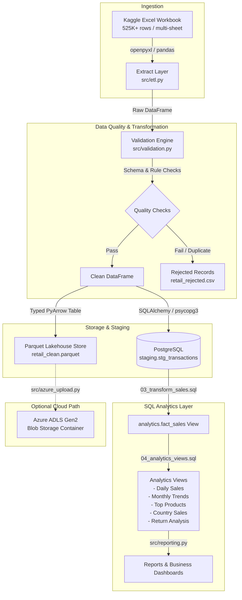
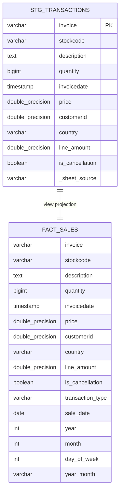

# 🏗️ Architecture & Technical Design Document

## 1. System Overview

The **Retail Sales Data Engineering Pipeline** is an end-to-end data processing system built to ingest, validate, standardize, and transform retail transaction records. It addresses real-world data quality issues common in e-commerce transaction systems—such as missing customer IDs, non-numeric prices, duplicates, cancellations, and returns—before delivering analytics-ready datasets to PostgreSQL and cloud object storage.

---

## 2. Key Architectural Decisions & Trade-Offs

### 2.1 ETL vs. ELT Hybrid Architecture
* **Extract & Initial Transform (ETL):** Raw Excel data is cleaned, validated, and normalized in Python. Invalid rows and duplicates are segregated *before* database loading. This prevents polluting the relational database with malformed data types or corrupt data.
* **Transform for Analytics (ELT):** Once in PostgreSQL staging, business classifications (identifying sales vs. returns vs. cancellations, date truncations, aggregates) are computed via SQL views (`analytics.fact_sales`). This leverages PostgreSQL's relational query engine for fast set-based transformations.

### 2.2 Storage: Parquet vs. CSV vs. Relational
| Format | Role | Why Used |
|---|---|---|
| **Parquet** | Analytical File Store | Columnar format with snappy compression. Allows projection pushdown (reading only required columns) and predicate pushdown. ~85% smaller than CSV. Standard format for modern cloud data lakes. |
| **CSV** | Rejected Audit Log | Human-readable with UTF-8 BOM (`utf-8-sig`) so business auditors can inspect rejected transactions directly in Excel without specialized tools. |
| **PostgreSQL** | Staging & Analytics Mart | Relational database with ACID transactions, indexing, window functions, and SQL interface suitable for BI tools (Tableau, PowerBI, Metabase). |

### 2.3 Idempotency Strategy
* **Local Files:** Parquet and CSV files are written with atomic overwrite semantics. Running the pipeline multiple times on the same input yields identical outputs without duplicating records.
* **Database Staging:** Uses a transactional `replace` strategy (`if_exists="replace"` in chunked batches) inside a database transaction. A failed run rolls back cleanly, leaving no orphaned partial loads.

---

## 3. Data Flow & Stage Breakdown

### Stage 1: Extraction (`src/etl.py`)
1. Verifies that the source file exists and is readable.
2. Inspects sheet names without loading full datasets using `openpyxl.load_workbook(read_only=True)`.
3. Discovers both sheets (`Year 2009-2010` and `Year 2010-2011`).
4. Normalizes headers on each sheet and verifies schema compatibility.
5. Concatenates compatible sheets and tags records with `_sheet_source` for end-to-end data lineage.

### Stage 2: Validation & Cleansing (`src/validation.py`)
Applies deterministic validation rules:
1. **Schema Check:** Ensures required columns (`invoice`, `stockcode`, `quantity`, `invoicedate`, `price`) exist.
2. **Missing Value Check:** Flags records with null or whitespace-only invoice or stock codes.
3. **Type Coercion:** Coerces quantity and price to numeric. Rows with non-numeric garbage (e.g. text prices) are flagged with rejection reason `non_numeric_price`.
4. **Date Validation:** Safely coerces timestamps.
5. **Business Constraint Check:**
   - `price < 0`: Rejected (`negative_price`).
   - `price == 0`: Valid (free samples / promotional items).
   - `quantity < 0`: Valid (handled as return or credit note).
6. **Duplicate Detection:** Composite key deduplication across `(invoice, stockcode, invoicedate, quantity, price)`. First occurrence is retained; subsequent rows are flagged as `duplicate`.
7. **Reconciliation Invariant:**
   $$\text{Input Rows} = \text{Clean Rows} + \text{Rejected Rows}$$

### Stage 3: Parquet Transformation (`src/transform.py`)
1. Casts DataFrame columns into explicit PyArrow data types (preventing type drift).
2. Writes columnar Parquet file with Snappy compression and 100K-row row groups.
3. Performs automated read-back roundtrip verification comparing row counts and schema.

### Stage 4: PostgreSQL Staging Load (`src/load_postgres.py`)
1. Safely constructs SQLAlchemy engine using URL-encoded credentials (`quote_plus`).
2. Checks if the `retail_dw` database exists; if not, connects to `postgres` admin DB to create it with `AUTOCOMMIT`.
3. Executes DDL scripts `01_create_schema.sql` and `02_create_staging.sql`.
4. Loads data to `staging.stg_transactions` using chunked multi-row inserts (`chunksize=5000`).
5. Adds B-tree indexes on `invoicedate`, `customerid`, `country`, and `is_cancellation`.

### Stage 5: SQL Analytics & Reporting (`sql/` & `src/reporting.py`)
1. Executes `03_transform_sales.sql` to build the `analytics.fact_sales` view.
2. Executes `04_analytics_views.sql` to construct KPI views:
   - `v_daily_sales`: Daily transaction count, gross/net revenue, return values.
   - `v_monthly_trends`: Month-over-month sales, average order value (AOV).
   - `v_top_products`: Revenue and units sold per stock code.
   - `v_country_sales`: Geographical distribution of revenue and customer counts.
   - `v_return_analysis`: Breakdown of sales vs. returns vs. cancellations.
3. Executes `05_quality_checks.sql` asserting table row counts, null constraints, and mathematical invariants (`line_amount = quantity * price`).

### Stage 6: Cloud Extension (`src/azure_upload.py`)
1. Connects to Azure ADLS Gen2 using `azure-storage-blob` SDK.
2. Uploads `retail_clean.parquet` to `processed/` and `retail_rejected.csv` to `rejected/`.
3. Designed as an optional extension: skips gracefully when credentials are not configured, preserving 100% offline local functionality.

---

## 4. Database Schema Design

### Logical Entity-Relationship Overview

---

## 5. Security & Configuration Best Practices

1. **Zero Secret Leakage:**
   - Password is read strictly from `.env` via `src/config.py`.
   - Never logged or printed in stack traces or string representations (`repr(DatabaseConfig)` masks the password).
   - `.env` is excluded in `.gitignore`.
2. **Safe URL Construction:**
   - Passwords containing special characters (e.g. `@`, `#`, `%`, `&`) are safely escaped using `urllib.parse.quote_plus`.
3. **Least Privilege Principle:**
   - Pipeline uses dedicated schemas (`staging`, `analytics`).
   - Downstream reporting users and dashboards can be restricted to `GRANT SELECT ON ALL TABLES IN SCHEMA analytics`.
